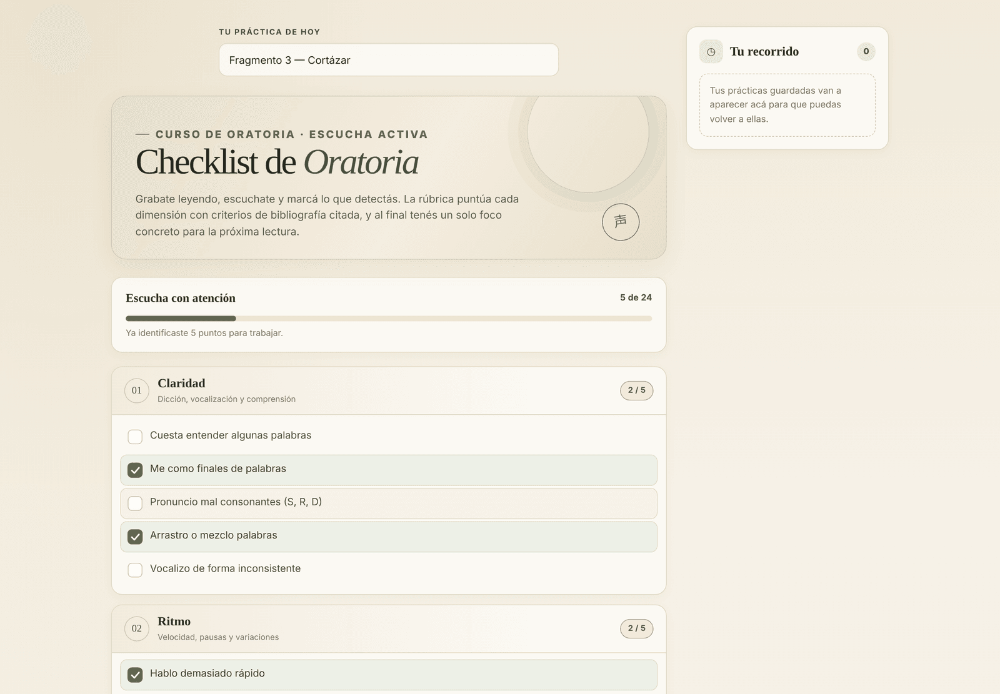
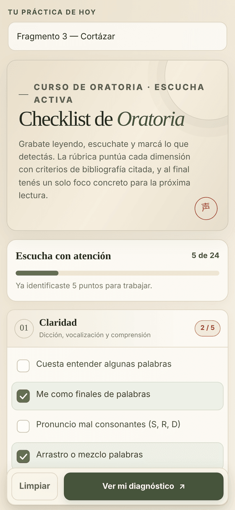
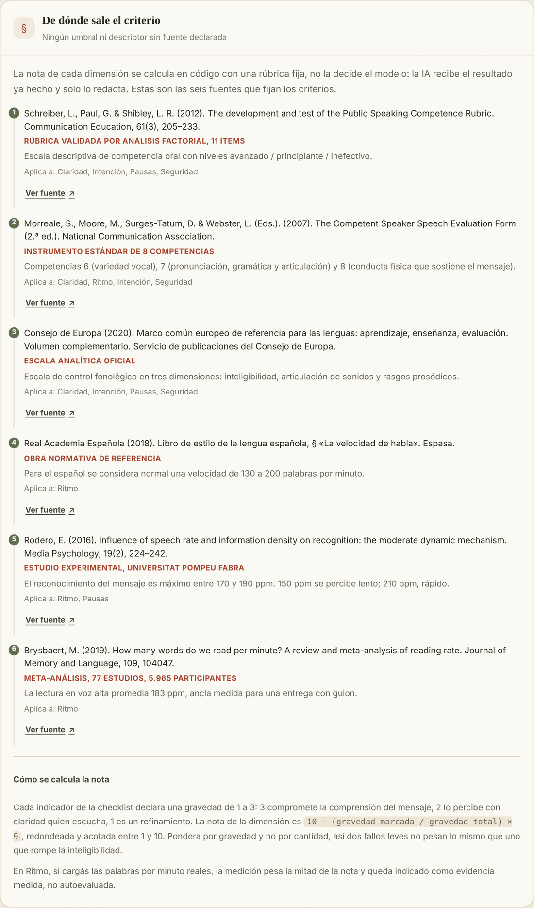

# Checklist de Oratoria

App web para autoevaluar grabaciones de lectura en voz alta. Marcás lo que detectás al escucharte, una rúbrica puntúa cada dimensión y salís con un solo foco concreto para la próxima grabación.

   



<p align="center">
  
</p>

## Lo que la diferencia

Pedirle a un modelo "evaluá esta oratoria" devuelve algo plausible, no algo verificable: la nota cambia entre corridas y el criterio no se puede auditar.

Acá **el criterio vive en código y cada umbral declara su fuente**. La rúbrica calcula nota, área crítica y prioridad de forma determinista; el modelo recibe ese resultado ya hecho y solo lo interpreta y lo redacta. Mismos datos de entrada, misma evaluación, siempre.

Consecuencia práctica: si la API falla o te quedás sin clave, las notas, el área crítica y la corrección sugerida **siguen funcionando**, porque esa parte no depende de la IA.



## Las fuentes

| Fuente | Aporta | Aplica a |
|---|---|---|
| Schreiber, Paul & Shibley (2012), *Public Speaking Competence Rubric*, Communication Education 61(3) | Escala descriptiva validada por análisis factorial | Claridad, Intención, Pausas, Seguridad |
| Morreale, Moore, Surges-Tatum & Webster (2007), *The Competent Speaker Speech Evaluation Form*, 2.ª ed., NCA | Competencias 6, 7 y 8 | Claridad, Ritmo, Intención, Seguridad |
| Consejo de Europa (2020), *MCER, Volumen complementario* | Escala de control fonológico en tres dimensiones | Claridad, Intención, Pausas, Seguridad |
| Real Academia Española (2018), *Libro de estilo de la lengua española* | Rango normal del español: 130–200 ppm | Ritmo |
| Rodero (2016), *Media Psychology* 19(2) | Reconocimiento máximo entre 170 y 190 ppm | Ritmo, Pausas |
| Brysbaert (2019), *Journal of Memory and Language* 109 | Meta-análisis: lectura en voz alta a 183 ppm | Ritmo |

## Cómo se calcula la nota

Cada indicador declara una gravedad de 1 a 3 — 3 compromete la comprensión, 2 lo percibe con claridad quien escucha, 1 es un refinamiento:

```
nota = redondear(10 − (gravedad marcada / gravedad total) × 9)
```

Pondera por gravedad y no por cantidad: dos fallos leves no equivalen a uno que rompe la inteligibilidad.

**Ritmo** es el único criterio con umbral medible. Si cargás las palabras del texto y la duración, la app calcula las ppm reales en el navegador y la medición pesa la mitad de la nota, declarada como evidencia medida y no autoevaluada.

| Rango | Estado | Nota |
|---|---|---|
| < 130 ppm | muy lento | 4 |
| 130–169 | lento | 7 |
| 170–190 | **óptimo** | 10 |
| 191–200 | algo rápido | 7 |
| > 200 | muy rápido | 4 |

## Stack

- React 18 + Vite 6
- CSS con variables, sin frameworks
- Motor de criterios en JS plano, sin dependencias
- Anthropic API (claude-haiku) vía función serverless de Vercel

```bash
npm install
npm run dev
```

El diagnóstico redactado necesita `ANTHROPIC_API_KEY` en el entorno (ver `.env.example`). La rúbrica funciona sin ella.

## Estructura

```
api/
└── diagnostico.js        función serverless; recalcula la rúbrica del lado del servidor
src/
├── App.jsx
├── motor/                ← capa de criterio, portable a otro proyecto
│   ├── marco.js          criterios, gravedades, umbrales y fuentes citadas
│   ├── rubrica.js        cálculo determinista
│   ├── prompt.js         armado del prompt acotado
│   └── README.md
├── hooks/
│   └── useRevelado.js    revelado al scrollear
├── data/bloques.js
└── components/
    ├── Header.jsx
    ├── Bloque.jsx
    ├── Item.jsx
    ├── Medicion.jsx      velocidad real de lectura
    ├── Diagnostico.jsx
    ├── Resultado.jsx
    ├── Fuentes.jsx       bibliografía y método visibles en la UI
    └── Historial.jsx
```

## El motor como preset

`src/motor/` no depende de React ni de esta app. Se copia la carpeta a otro proyecto, se reescribe `marco.js` con la bibliografía y los criterios del dominio nuevo, y `rubrica.js` sigue sirviendo sin tocarse. Detalle completo en [`src/motor/README.md`](src/motor/README.md).

## Uso

1. Grabate leyendo un fragmento, mínimo 2 minutos
2. Escuchate y marcá los problemas que detectás
3. Opcional: cargá palabras y duración para medir tu velocidad real
4. Opcional: anotá un momento concreto para darle contexto al análisis
5. **Ver mi diagnóstico** y guardá la práctica para comparar contra las anteriores

## Licencia

MIT
